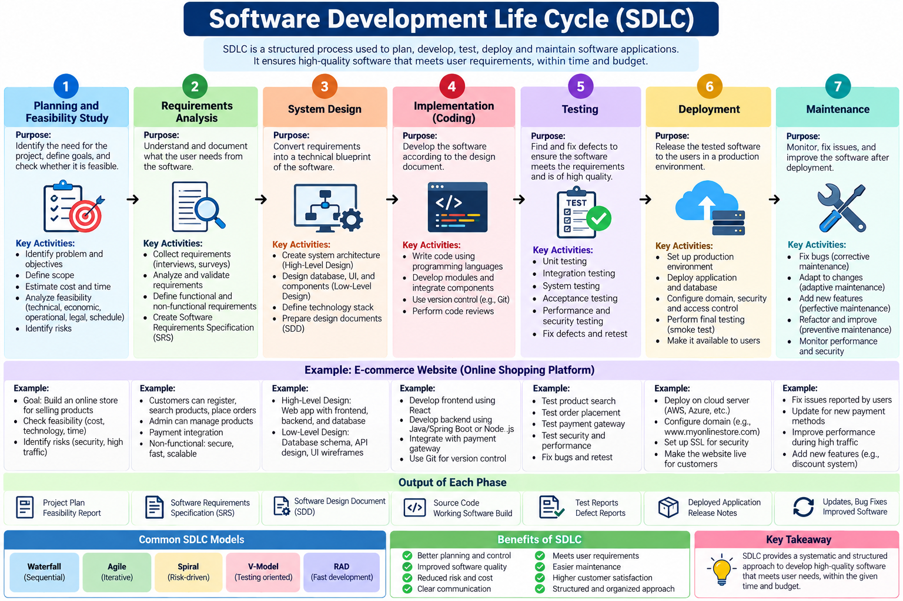
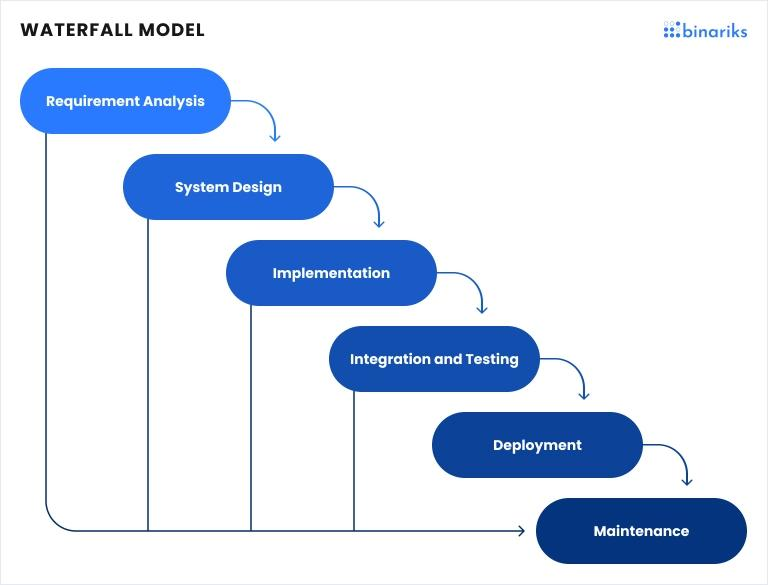
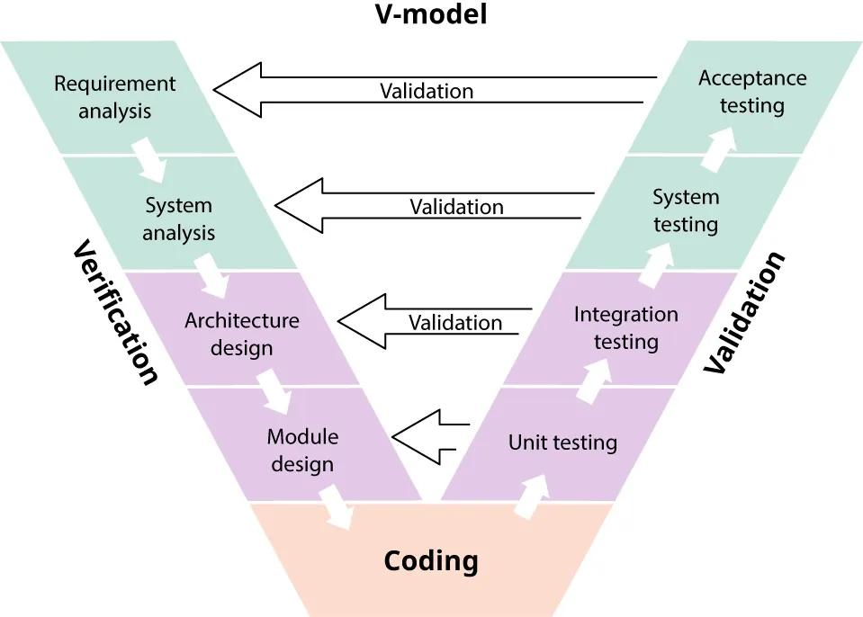
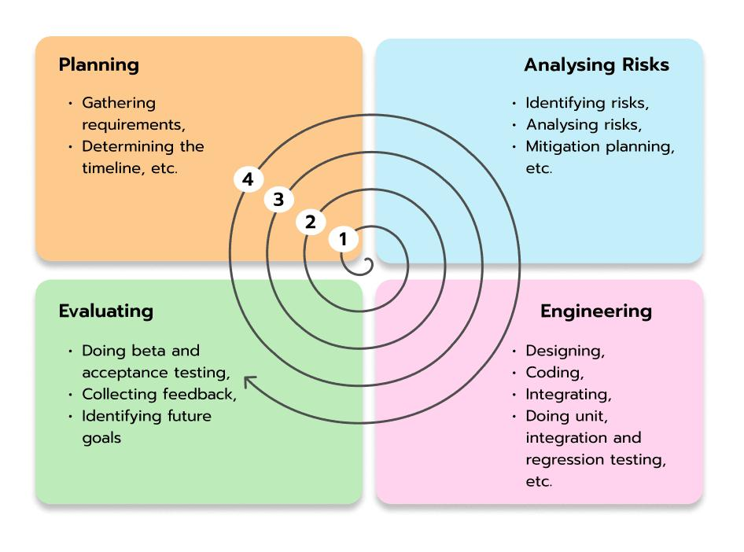

# SDLC (Software Development Life Cycle) — Explained in Detail

## 1. What is SDLC?
SDLC stands for Software Development Life Cycle.
It is a systematic process used to plan, design, develop, test, deploy, and maintain software. It provides a structured approach to building software that meets user requirements, maintains quality, stays within budget, and is delivered on time.
In simple words, SDLC describes the complete journey of software, from an initial idea to a working application and its ongoing maintenance.
### Real-life example
Suppose you want to develop a College Placement Portal where students can view job opportunities, upload resumes, and apply for placements.
You cannot directly start writing code. First, you must understand what the college needs, plan the project, design the application, develop it, test it, deploy it, and maintain it.
That complete process is called SDLC.

<p align="center">
  
</p>

## 2. Phase 1: Planning and Feasibility Study

### Definition

The planning phase is the initial phase of SDLC in which the project's objectives, scope, estimated cost, required resources, schedule, and potential risks are identified. A feasibility study determines whether the proposed software is practical and worth developing.

### What happens in this phase?

- Identify the problem that needs to be solved.
- Define the project's goals and scope.
- Estimate the budget and development time.
- Identify the required team members, hardware, and software.
- Analyze technical, economic, operational, and schedule feasibility.
- Identify major risks.

### Types of feasibility

| Type | Meaning | Placement Portal example |
|---|---|---|
| Technical | Can we build it with available technology? | Can we use React, Node.js, and MongoDB? |
| Economic | Is it financially worthwhile? | Is the expected cost acceptable to the college? |
| Operational | Will users be able to use it effectively? | Can students and placement officers use it easily? |
| Schedule | Can we finish within the deadline? | Can the portal be ready before placement season? |
| Legal | Will it comply with relevant laws and policies? | Can student data be collected and stored lawfully? |

### Example

The college wants a placement portal before the next placement season.

The team estimates that it will take 8 weeks, requires 3 developers, and can be developed using existing technology within the available budget.

The team also identifies a risk: student resumes contain personal information, so access controls and data protection must be considered.

**Output of this phase:** Project proposal, feasibility report, estimated budget, timeline, scope, and initial risk assessment.

## 3. Phase 2: Requirements Analysis

### Definition

Requirements analysis is the phase in which the development team collects, analyzes, documents, and validates the needs and expectations of stakeholders.

Stakeholders include the people who use, manage, fund, or otherwise depend on the software.

### Types of requirements

**A. Functional requirements**

These describe what the software must do.

Examples for the Placement Portal:

- Students can register and log in.
- Students can upload their resumes.
- Students can view available jobs and internships.
- Students can apply for eligible jobs.
- Placement officers can post job openings.
- Administrators can manage student and company records.

**B. Non-functional requirements**

These describe how well the software must operate or the constraints under which it operates.

Examples:

- Performance: job listings should load quickly under expected usage.
- Security: unauthorized users must not access student resumes.
- Availability: the portal should be accessible during placement activities.
- Usability: the interface should be easy for students to navigate.
- Scalability: the system should support increased student traffic.

### How are requirements collected?

- Interviews with placement officers.
- Questionnaires for students.
- Meetings with college administrators.
- Studying the existing placement process.
- Reviewing policies and existing documents.

### Example

After interviewing stakeholders, the team discovers that students need to see application deadlines, while placement officers need to shortlist candidates.

The team documents these requirements and confirms them with the college before development begins.

**Output of this phase:** Software Requirements Specification (SRS) document.

The SRS acts as an agreement about what the software should do and provides a foundation for design and testing.

## 4. Phase 3: System Design

### Definition

The system design phase converts the requirements documented in the SRS into a technical blueprint that explains how the software will be structured, how its components will interact, and how data will be stored and processed.

In simple words, the requirements phase determines **what to build**, while the design phase determines **how to build it**.

### Types of system design

**A. High-Level Design (HLD)**

HLD describes the overall architecture of the system and its major components.

For the Placement Portal, the architecture could look like this:

**Frontend**

React.js — student and admin interfaces

**Backend**

Node.js + Express.js — business logic and APIs

**Database**

MongoDB — students, jobs, applications

**B. Low-Level Design (LLD)**

LLD describes the internal details of individual components, such as classes, functions, database fields, validation rules, and API behavior.

For example, the team might design a Student entity with the following fields:

```java
class Student {
    String studentId;
    String name;
    String email;
    String resumeUrl;
}
```

This is an illustrative data model; the actual implementation might use a JavaScript object or a MongoDB schema instead.

The team also designs the job application process:

1. A student selects a job.
2. The backend verifies the student's eligibility.
3. The system checks whether the student has already applied.
4. The application is saved in the database.
5. The system returns a success or error response.

### Other activities in design

- Designing UI wireframes and page layouts.
- Designing the database schema.
- Defining API endpoints.
- Selecting technologies and architecture.
- Planning authentication, authorization, and security controls.

**Output of this phase:** Software Design Document (SDD), architecture diagrams, database schema, API specifications, and UI prototypes.

## 5. Phase 4: Implementation (Coding)

### Definition

Implementation is the phase in which developers translate the approved design into executable source code using appropriate programming languages, frameworks, libraries, and development tools.

In simple words, this is where developers actually build the software.

### What happens in this phase?

- Developers create frontend interfaces.
- Backend developers implement business logic and APIs.
- Database developers create schemas and queries.
- Developers integrate the frontend, backend, and database.
- Code reviews and basic automated checks may be performed.
- Developers use version control tools such as Git to manage changes.

### Example

Suppose the requirement states:

Students must be able to view available placement opportunities.

The developer implements an API in Node.js and Express.js:

```javascript
app.get("/api/jobs", async (req, res) => {
    try {
        const jobs = await Job.find();
        res.status(200).json(jobs);
    } catch (error) {
        res.status(500).json({
            message: "Unable to fetch jobs"
        });
    }
});
```

This illustrative endpoint retrieves job records from MongoDB and returns them as JSON.

The frontend then calls this endpoint and displays the job listings to students.

**Output of this phase:** Source code, database integration, application modules, and a working software build.

## 6. Phase 5: Testing

### Definition

Testing is the process of evaluating software to identify defects and verify that it satisfies the specified functional, performance, security, and quality requirements.

The objective is to discover problems before they affect real users.

### Types of software testing

| Testing type | Purpose | Placement Portal example |
|---|---|---|
| Unit testing | Tests individual functions or components | Verify the function that validates student eligibility |
| Integration testing | Tests interactions between components | Verify that the backend correctly saves an application to MongoDB |
| System testing | Tests the complete application | Verify the complete login-to-job-application workflow |
| Acceptance testing | Checks whether the software meets user needs | Placement officers confirm that shortlisting works as expected |
| Performance testing | Evaluates performance under a workload | Check whether job listings load properly when many students access the portal |
| Security testing | Finds security weaknesses | Check whether a student can access another student's private resume |

### Example of testing

Suppose a student applies for a job.

The tester checks several scenarios:

- Test case 1: An eligible student applies successfully.
- Test case 2: An ineligible student is prevented from applying.
- Test case 3: A student cannot apply twice if duplicate applications are prohibited.
- Test case 4: An unauthenticated user cannot submit an application.
- Test case 5: A database failure produces a suitable error instead of crashing the application.

If a student can apply twice despite the requirement, the tester reports a defect. Developers fix the issue, and the affected functionality is tested again.

This repeated process of finding, fixing, and retesting defects helps improve software quality.

**Output of this phase:** Test cases, test reports, defect reports, and a verified software build.

Note that testing is not always limited to one isolated phase. Modern teams also test code throughout development.

## 7. Phase 6: Deployment

### Definition

Deployment is the process of releasing the tested software into an environment where its intended users can access and use it.

A software application running only on a developer's laptop is not necessarily available to its intended users. Deployment makes the application accessible in its target environment.

### Types of deployment

- Development deployment: Used by developers while building the application.
- Staging deployment: A production-like environment used for final checks.
- Production deployment: The environment where actual users use the software.

### Example

The Placement Portal has passed the required tests. The team now:

1. Deploys the React frontend to a hosting platform.
2. Deploys the Node.js backend to a server or cloud platform.
3. Configures the production MongoDB database.
4. Sets environment variables and secure credentials.
5. Configures the domain, HTTPS, and access controls.
6. Runs smoke tests to verify the deployed application.
7. Makes the portal available to students and placement officers.

The college can now share the portal's web address with students.

**Output of this phase:** A released, accessible application, deployment configuration, and release documentation.

Deployment can happen in stages, such as a pilot release to a small group of users followed by a broader rollout.

## 8. Phase 7: Maintenance

### Definition

Maintenance is the phase in which software is monitored, corrected, updated, and improved after deployment so that it continues to meet user needs and operate reliably.

**Important:** Software development does not end when the application is deployed. Maintenance is an ongoing activity.

### Types of software maintenance

| Type | Meaning | Placement Portal example |
|---|---|---|
| Corrective | Fixes existing defects | Fix a bug that prevents students from uploading resumes |
| Adaptive | Adjusts software to a changed environment | Update the application to support a new server or runtime version |
| Perfective | Improves performance or functionality | Add job filters by company, location, or salary |
| Preventive | Reduces the risk of future problems | Refactor poorly structured code and update vulnerable dependencies |

### Example

After the portal has been used for a few months, the college reports that students want email notifications for new jobs. The team adds this feature, tests it, and deploys an update.

Meanwhile, the team monitors errors, fixes defects, updates dependencies, reviews security, and backs up important data.

**Output of this phase:** Bug fixes, patches, new features, performance improvements, security updates, and updated documentation

## 9. Advantages and Importance of SDLC

SDLC is important because it provides a structured way to manage software projects from beginning to end.

1. **Better planning:** Helps estimate project cost, time, and resources.
2. **Clear requirements:** Reduces misunderstandings between developers and clients.
3. **Improved software quality:** Testing helps identify defects before release.
4. **Reduced risk:** Technical, financial, and security risks can be identified early.
5. **Better documentation:** Makes software easier to understand and maintain.
6. **Cost control:** Finding problems early can reduce the cost of fixing them later.
7. **Easier maintenance:** A well-structured application is easier to modify and extend.
8. **Customer satisfaction:** The finished product is more likely to meet user expectations.

## 10. What Are SDLC Models?

An SDLC model defines how the phases of the software development life cycle are organized and carried out.

The seven phases describe what activities are needed. The model describes how those activities are arranged and repeated.

The major SDLC models are:

### 1. Waterfall Model

The **waterfall model** is a linear and sequential software development model in which one stage is finished before the next is started. It provides a structured, predictable process that works for well-defined, stable projects where stakeholders want to be involved only during the review of major milestones.

This model is not very flexible because it requires the completion of each phase before starting a new one. This might make it difficult and time-consuming to correct work in previous phases after completion.
<p align="center">
  
</p>

### 2. V-Model

The **V-model**, or **V-shaped model**, is a variation of the [waterfall model](https://www.ibm.com/think/topics/agile-vs-waterfall) and is sometimes called the **verification and validation model**. In the V-model, each phase of the SDLC has its own accompanying testing phase.

Frequent testing helps eliminate bugs early on, but the linear structure makes the V-model (like the waterfall model) less flexible than other methodologies. However, it does work well for software with stable requirements that requires frequent testing.
<p align="center">
  
</p>

### 3. Spiral Model

In the **spiral model**, four phases—determining objectives, resource and risk analysis, development and testing, and planning for the next iteration—occur in a repeating cycle, hence the “spiral” name.

With the regular repetition of these four phases, there are multiple opportunities for correction, making this model ideal for high-risk or complex projects where frequent changes are expected.

<!--  -->
<p align="center">
  
</p>